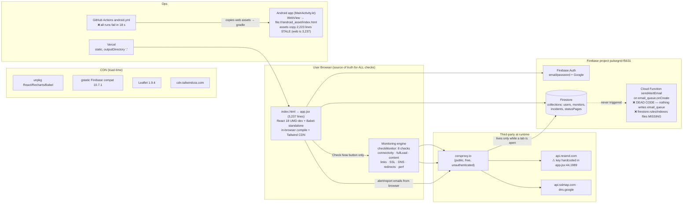

# PulseGrid — Phase 0 Forensic Audit

> Date: 2026-10-19 · Branch `main` @ `1058d7e` · Live: https://pulse-grid-seven.vercel.app
> Phase 0 rules honored: **no code changes, no installs, no deploys.** Findings marked ✅ Confirmed (evidence: file:line) or ❓ Unverified.

---

## 1. Executive Summary

PulseGrid is a **static React SPA** (in-browser Babel compilation, no build step) backed by **Firebase Auth + Firestore**, deployed to **Vercel**. The deep-monitoring engine (8 real checks) is genuinely implemented — but the **core product promise is not delivered**: checks run *only* when a logged-in user clicks "Check Now" in an open browser tab. There is **no scheduler anywhere** (`intervalSeconds` is stored and never read). "24/7 monitoring" copy, the fake node-registration terminal, and "First ping successful!" on monitor creation are UI theater.

**Top risks:** (1) Resend API key hardcoded client-side and routed through a public CORS proxy — rotatable/abusable; (2) Firestore security rules **cannot be verified** (`firestore.rules` referenced by `firebase.json` does not exist locally) — possible cross-tenant data leak; (3) incident auto-resolution condition can never fire on full recovery, so incidents stick open forever and recovery emails never send; (4) `uptimePercentage` is written once as `100` and never updated — every uptime figure in the product is fake; (5) all "multi-region" checks actually run from the user's own browser; (6) the Android CI build fails in 18 s (earliest steps — exact step needs authenticated logs).

Everything else — status pages, API access, Slack/Discord alerts, billing, team management, PWA — is **stored-but-never-executed or placeholder**.

**Verdict:** Frontend/demo quality is high; backend honesty and reliability are the gap. Phase 1 should focus on *making stored settings real* (scheduler, resolution, uptime) and *closing security* (key rotation, rules), not new features.

---

## 2. Architecture (Mermaid)



---

## 3. Feature Matrix (claimed vs. actual)

| Feature | Status | Evidence / Reality |
|---|---|---|
| Email/password auth, reset, verification | ✅ Real | app.jsx:851–943, 3119; spam-folder warnings added (done). Login does **not** gate on `emailVerified` (app.jsx:888) |
| Google sign-in | ⚠️ Web only | signInWithPopup app.jsx:904; broken on Android WebView (needs SHA-1 in Firebase Console — user-side) |
| Deep checks (8 types) | ✅ Real code | checkMonitor app.jsx:607–650; all via `corsproxy.io` (app.jsx:331,345,421,438,455,470) |
| **Scheduled/24-7 checks** | ❌ **Missing** | No `setInterval`/scheduler anywhere; only manual `handleCheck` (app.jsx:1045). `intervalSeconds` saved (1294), never read |
| Multi-region monitoring | ❌ Label only | All 12 "regions" (MONITORING_REGIONS app.jsx:171) execute **from the user's browser**; region only tags results |
| Monitor creation "first ping" | ❌ Theater | `runTerminal` scripted delays (1269–1282); "✅ First ping successful!" (1304) — **no check is run**; status saved `pending` (1301) |
| Incident creation (plain-English) | ✅ Real | checkAllMonitors app.jsx:686–699 |
| **Incident auto-resolution** | ❌ Broken | Condition `else if (anyRegional && m.status === 'down')` (708): on full recovery both flags are false → **incident never resolves, no recovery email** |
| Alert-after-N-failures | ❌ Ignored | `alertAfterFailures` stored (1300), never read; incident created on 1st failure |
| Recovery notification pref | ❌ Ignored | stored (1300), never read |
| Email alerts (down/recovery) | ⚠️ Works, insecure | browser → corsproxy → Resend with hardcoded key (41–136); only fires during manual Check Now |
| Slack/Discord webhooks | ❌ Dead | inputs UI (1497,1501), stored (1299), **never called** |
| Notification prefs / quiet hours | ❌ Dead | saved to `users` (2968), never read |
| Uptime percentage | ❌ Fake | set `100` at creation (1301); `batch.update` (731–737) never updates it — dashboards/reports/SLA all show 100 |
| Response time / check history | ✅ Real | `avgResponseMs`, `checkHistory` updated (731–737), last 48 entries |
| Pause/resume | ⚠️ Cosmetic | `isPaused` not filtered in dashboard check path (1077–1080, 659) → **Check Now still checks paused monitors** |
| Status pages (internal CRUD) | ✅ Real | Firestore `statusPages` (1780–1935) |
| **Public status page** | ❌ Missing | Publish toggle (1807) exists but **no public/slug view anywhere**; custom-domain CNAME claim fictional |
| Reports | ⚠️ Half real | monitors real; `totalOutages = 0`, `totalChecks = n*1440` hardcoded (2038–2039); dashboard chart = `Math.random()` (750) |
| Report email | ⚠️ Works, insecure | same Resend key (1989–2013) |
| API Access / API Docs | ❌ Fake | key = `'pg_live_' + uid.slice(0,8)` (2973); documents REST endpoints that don't exist (no backend; `vercel.json` has no routes) |
| Billing / plans | ❌ Placeholder | every user hard-coded `plan:'pro'` (866, 3130); M-Pesa/PayPal "Coming Soon" (3042) |
| Team management | ❌ "Coming soon" (3031) |
| Data export | ⚠️ Partial | exports only user profile, not monitors/incidents (2980–2986) |
| Account delete | ⚠️ Orphans data | deletes `users` doc + auth user (2988–2994), leaves monitors/incidents/statusPages behind |
| PWA (sw.js, manifest.json) | ❌ Orphaned | never registered/linked anywhere; `scope` empty |
| Android APK | ❌ CI broken; local build works (stale assets, see §5) |
| Capacitor | ❌ Unused | deps in package.json + config, but app is a plain WebView project |

---

## 4. End-to-End Traces

### A. Sign-up → dashboard
1. `handleSignUp` (851) → `createUserWithEmailAndPassword` → `updateProfile` → `sendEmailVerification` (errors only logged) → Firestore `users/{uid}` with `plan:'pro'` → `navigate('verify-email')`.
2. Verify screen (3191): resend w/ 60 s cooldown, "Continue" reloads user, spam-folder warning shown (done this session).
3. `onAuthStateChanged` (3119) loads/creates user doc → `dashboard`. **Login (889) does not check `emailVerified`** — unverified users reach the app directly on next login (❓ product decision to confirm).

### B. Create monitor → check (the critical gap)
1. AddMonitor 3-step wizard (1209); validation requires https:// URL.
2. `handleSubmit` (1273): fake terminal lines (`Registering with Nairobi node…` = `setTimeout` theater), Firestore insert with `status:'pending'`, then **"✅ First ping successful!" without any network check**.
3. Nothing happens until a user opens the Dashboard and clicks **Check Now** (1045) → `checkAllMonitors` (653): for each monitor × each configured region → `checkMonitor` (607) → 8 sequential fetches through `corsproxy.io` → one `db.batch()` update (`status`, `avgResponseMs`, `lastCheck`, `lastError`, `checkHistory` — **not** `uptimePercentage`, **not** pause-filtered).

### C. Incident lifecycle (broken recovery)
1. First failure (`anyDown && m.status !== 'down'`, 682) → Firestore `incidents` doc with title/description/timeline + `sendAlertEmail('down')` (686–707).
2. Recovery: requires `anyRegional && m.status === 'down'` (708). On genuine full recovery all regions are `'up'` → `anyRegional = false` → **neither branch runs**: incident stays open, no recovery email. Recovery only "works" when a region is in a partial/degraded state — premature and wrong.

### D. Alert email
`sendAlertEmail` (41): builds HTML (failed/passed checks, locations, type-specific advice) → `fetch('https://corsproxy.io/?https://api.resend.com/emails')` with `Bearer re_…` in browser (118–131). Cloud Function equivalent (functions/index.js) triggers on `email_queue` — **no code ever writes that collection** (❓ unverified if deployed at all; `functions/node_modules` absent).

### E. Android APK path
Push to `main` → workflow copies 6 web files over `android/.../assets/` (fresh) → Java 17 → manual SDK download → `gradlew assembleDebug` → upload + release. **All runs fail**: latest run `24940351565` for `1058d7e` failed in **18 s** with `exit code 1`, empty `steps[]`, only a Node-20 deprecation warning annotation → failure occurs **before** SDK/Gradle (those take minutes). Logs endpoint returns 403 without repo admin (❓ exact step unverifiable read-only; `npm install` is the most likely candidate since it's the first command able to exit 1 that fast and all `cp` sources exist).

---

## 5. Ranked Bugs & Security Risks

| # | Sev | Finding | Evidence |
|---|---|---|---|
| 1 | 🔴 P0 | **Resend API key hardcoded in client** (×2) and sent through public `corsproxy.io` — anyone can exfiltrate and send mail as PulseGrid / burn quota. Also duplicated in `functions/index.js:7` | app.jsx:44, 1989 |
| 2 | 🔴 P0 | **Firestore rules unverifiable — `firestore.rules` and `firestore.indexes.json` referenced by `firebase.json` DO NOT EXIST locally.** If deployed rules are open/test-mode, any user can read every user's monitors/incidents/emails. First Phase-1 action | firebase.json:7–8, glob = no file |
| 3 | 🔴 P0 | **No background monitoring** — checks exist only while a user clicks the button in an open tab. Product promise ("watching 24/7", "alerted if down for 15 min") is false | no scheduler; app.jsx:1045 |
| 4 | 🔴 P1 | **Incidents never auto-resolve on recovery** (condition unreachable on full recovery) → permanent red incidents, no recovery emails | app.jsx:708 |
| 5 | 🔴 P1 | **Fake "First ping successful!"** on creation — no check runs; new monitors sit `pending` | app.jsx:1282–1304 |
| 6 | 🟠 P1 | **Uptime always 100%** — `uptimePercentage` never updated anywhere; reports/SLA/dashboard uptime all fabricated | 1301 vs 731–737 |
| 7 | 🟠 P1 | **"Multi-region" is fake** — all checks from one browser; eHub Market results reflect *your* machine/network, not Nairobi/Frankfurt/New York | app.jsx:171–184, 607 |
| 8 | 🟠 P1 | **Paused monitors still checked** by Check Now (no `isPaused` filter) → status overwritten, incidents possible on paused monitors | 1077–1080, 659 |
| 9 | 🟠 P1 | **CI APK build fails in 18 s** (all recent runs); local build works but ships **stale assets** (2,223 vs 3,237 lines) — APK misses deep monitoring, Leaflet map, incident UI | android.yml; assets\app.jsx |
| 10 | 🟠 P2 | Settings that lie: Slack/Discord never sent, `notificationPrefs`/quiet hours never read, `alertAfterFailures`/`recoveryNotification`/`intervalSeconds` ignored | 1232–1233, 2968 |
| 11 | 🟠 P2 | Status page **Publish is a dead toggle** — no public renderer; custom-domain instructions fictional | 1807, no slug route |
| 12 | 🟠 P2 | **Fake API key + API Docs documenting nonexistent REST API** (no backend) | 2973, APIDocsPage 2285 |
| 13 | 🟡 P2 | Alert-email bug: `checks.broken`/`checks.checked` referenced instead of `checks.linkValidation.*` → "undefined of undefined" in Links row | app.jsx:60 |
| 14 | 🟡 P2 | Account delete orphans monitors/incidents/statusPages; data export omits all app data | 2988, 2980 |
| 15 | 🟡 P2 | Every user gets `plan:'pro'`; upgrade modal says "free plan limit of 100" — plan logic contradictory | 866, 3130, 1242 |
| 16 | 🟡 P2 | `firebase.json` hosting `public: "."` would publish **the entire repo (incl. embedded keys)** if Firebase Hosting were ever used | firebase.json:11 |
| 17 | 🟡 P3 | Cloud Function on `nodejs18` runtime (deprecated platform) + `email_queue` dead path → email infra split-brain | functions/* |
| 18 | 🟡 P3 | Production serves React **development** builds + in-browser Babel → slow first paint | index.html:17–21 |
| 19 | 🟡 P3 | Repo hygiene: orphaned `index-full.html`, `sw.js`/`manifest.json` unlinked, unused Capacitor deps, `android/.idea/misc.xml` dirty | glob/grep results |
| 20 | 🟢 P3 | `checkAllMonitors` uses one batch — one deleted monitor fails the whole commit (race) | 731–740 |

❓ **Unverified items:** deployed Firestore rules content; whether the Cloud Function is deployed; exact failing CI step; whether composite indexes exist (equality-only queries likely fine via index merging).

---

## 6. Documentation vs. Implementation

| Doc says | Reality |
|---|---|
| START.md: PostgreSQL backend, `backend/` folder, JWT, `.env`, `node setup.js`, test account `test@pulsegrid.io` | ❌ **`backend/` does not exist** (removed in Firebase-only refactor). The entire guide, API table (§Endpoints) and troubleshooting are obsolete |
| START.md: Email/**Slack/Discord** alerts, Status pages, Reports, Team management | Email ⚠️, Slack/Discord ❌, Status pages ⚠️ no public view, Reports half, Team ❌ |
| Firebase: `firebase.json` → `firestore.rules`, `firestore.indexes.json` | ❌ Both files missing |
| `functions/index.js` email queue | ❌ Nothing enqueues; client bypasses it |
| Add-monitor copy: "watching 24/7", "first ping successful", "alert after 15 minutes" | ❌ No scheduler, no first check, failure threshold ignored |
| Status page: "Add CNAME → pages.pulsegrid.io" | ❌ No such host/route |
| API Docs: REST endpoints `/api/monitors` etc. | ❌ No server exists |
| package.json "API Uptime Monitoring SaaS" | ⚠️ Accurate as *description*, but `dev` script (`npx serve`) downloads at runtime; `server.js` is the real local server |
| PWA manifest/service worker | ❌ Never wired |
| Capacitor config | ❌ Unused (raw WebView project instead) |

---

## 7. Why Things Are Unfinished (assessed)

- **Postgres backend deleted during "Switch to Firebase only" refactor** (git history) but never replaced → no server = no scheduler = no Slack/Discord/API/public status pages. *Assessed from commit trail.*
- **Browser-only architecture has no daemon** — client-side checks can't run when the tab closes; solving monitoring requires one server-side component (Cloud Function/Vercel cron/worker), which was never added.
- **Payments/teams/API stubbed** for beta demo (billing copy literally says "Beta Access", `plan:'pro'` for all).
- **CI likely toolchain drift** (manual SDK wget, Node 20 deprecation, gradle wrapper): failed consistently since inception of the workflow (all 5 recent runs red) — *exact cause needs authenticated logs*.
- **Android assets stale** because CI fails before producing an APK; last local build predates the deep-monitoring/Leaflet work.

---

## 8. Minimal Recommended Architecture (keep, don't rewrite)

Keep: static SPA + Firebase Auth + Firestore + Vercel. Add **one** server-side piece:

```
Firestore (source of truth)
   ↑ writes results            ↓ reads due monitors
Scheduled Cloud Function (or 1 small worker: Vercel Cron /
Fly.io/Render — min 1-min cadence on hobby plans)
   • fetch target URL directly (server has no CORS → drop corsproxy.io)
   • writes status/uptime/incidents, sends Resend email
   • secrets via functions secret manager — remove ALL client keys
Firestore rules: allow read/write only if request.auth.uid == resource.data.userId (deploy!)
```

Client keeps: UI, manual "Check Now" (calls a function endpoint), auth, live Firestore subscriptions. Android unchanged (WebView). This is the smallest change that makes "24/7 monitoring" true.

---

## 9. Prioritized Roadmap (Phase 1+)

**Phase 1 — Truth & Security (stop the bleeding)**
1. Read/verify deployed Firestore rules; write + deploy `firestore.rules` locking `userId`; add `firestore.indexes.json`.
2. Rotate Resend key; move sending into one server-side function; delete client keys (app.jsx:44,1989 + functions).
3. Scheduler: server-side checks honoring `intervalSeconds`; then delete/replace fake "first ping" copy with a real initial check.
4. Fix incident lifecycle: resolve on full recovery + send recovery email; honor `alertAfterFailures`; filter `isPaused` in checks.
5. Compute real `uptimePercentage` from `checkHistory`.

**Phase 2 — Honesty pass**: apply notification prefs/quiet hours; Slack/Discord webhooks or remove UI; single-monitor re-check; remove or implement PWA/Capacitor/API-key stubs; fix Links-row bug (60); delete orphans (`index-full.html`); README replacing START.md.

**Phase 3 — Product**: public status pages (slug route), reports from real history, real region distribution (multi-node), CI APK fix + asset sync, billing/team.

---

## 10. Run Commands (as-is today)

```bash
# Local dev (static server, port 3000, SPA fallback)
node server.js                 # or: npm run dev  (= npx serve . -l 3000)
# No build step — app.jsx compiled in-browser by Babel standalone

# Deploy web
vercel --prod                  # vercel.json: no build, output "."

# Firebase (⚠ currently fails: missing firestore.rules/indexes; functions deps not installed)
npm --prefix functions install
firebase deploy --only firestore:rules,functions   # after Phase-1 files exist

# Android (local, works; assets must be synced first)
cp index.html app.jsx styles.css firebase.json manifest.json sw.js android/app/src/main/assets/
cd android && ./gradlew assembleDebug               # APK: app/build/outputs/apk/debug/
# CI equivalent: .github/workflows/android.yml  ❌ currently red
```

---

## 11. Required Credentials / Access

| Item | Why | Where |
|---|---|---|
| GitHub repo admin/auth (`gh auth login` or Actions UI) | Read failed CI logs (currently 403) | TrumperBee/PulseGrid |
| Resend account | **Rotate leaked key**, verify sender domain | resend.com |
| Firebase Console access (project `pulsegrid-f5631`) | Read/deploy Firestore rules; Google sign-in **SHA-1 fingerprint** (user-side, fixes Android Google login) | console.firebase.google.com |
| Firebase/GCP service account or CLI login | Deploy functions + rules (CLI 15.15.0 installed; not logged in) | `firebase login` |
| Vercel account/project | Confirm prod deploys & (later) cron | vercel.com |
| Android SDK + JDK 17 | Local APK builds (installed for previous build) | android cmdline-tools |
| (Later) hosting for worker if not using Cloud Functions | scheduled checks | Fly/Render/Vercel Cron |

No secrets were printed in this audit. Known secret *locations*: `app.jsx:44`, `app.jsx:1989`, `functions/index.js:7`, Firebase web config `app.jsx:23–30` (public-by-design, acceptable per user).

---

## 12. First Phase-1 Files to Touch

1. **`firestore.rules` (new)** — per-user ownership rules (currently missing entirely).
2. **`firebase.json`** — already points at it; add `firestore.indexes.json` (new).
3. **`functions/index.js`** — replace dead `email_queue` trigger: Resend send (secret-managed) + scheduled check runner; **`functions/package.json`** runtime bump from `nodejs18`.
4. **`app.jsx`** — remove client Resend calls (41–136, 1977–2014); fix recovery condition (708); pause filter (659/1077); uptime update (731); honest creation flow (1273–1304); Links-row bug (60).
5. **`START.md` → replace with `README.md`** — current guide describes a nonexistent backend.
6. **`.github/workflows/android.yml`** — fix early failure (needs logs), Node 24-capable action versions.
7. **`package.json`** — drop unused Capacitor deps (or wire Capacitor properly — decision needed).

---
*Report generated read-only. No source files, dependencies, or deployments were modified.*
